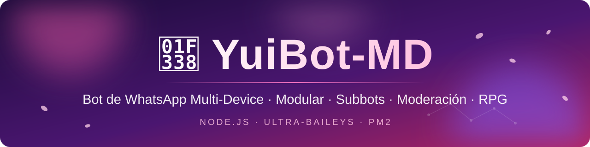
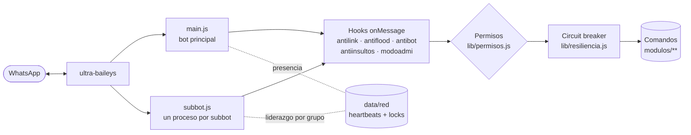

<div align="center">



<br/>

[](https://nodejs.org/)
[](https://www.whatsapp.com/)
[](#-comandos)
[](#-producción-con-pm2)
[](LICENSE)

[](https://github.com/AmilcarGit/YuiBot-MD/stargazers)
[](https://github.com/AmilcarGit/YuiBot-MD/network/members)
[](https://github.com/AmilcarGit/YuiBot-MD/commits/main)
[](https://github.com/AmilcarGit/YuiBot-MD/issues)

**[Características](#-características) · [Instalación](#-instalación) · [Subbots](#-subbots) · [Comandos](#-comandos) · [Configuración](#-configuración) · [Crear comandos](#-crea-tu-propio-comando) · [Ayuda](#-solución-de-problemas)**

<br/>


</div>

---

## 🌸 ¿Qué es YuiBot-MD?

**YuiBot-MD** es un bot de WhatsApp hecho con **Node.js** sobre [ultra-baileys](https://github.com/russellxz/ultra-baileys), pensado para grupos y comunidades: moderación completa, economía y RPG, descargas, stickers, utilidades y un sistema de **subbots** para que otras personas tengan su propio bot sin duplicar el servidor.

Está diseñado para ser **modular** (cada comando es un archivo), **resistente** (reconexión inteligente y circuit breaker por comando) y **fácil de mantener**.

> 🚧 **Proyecto en desarrollo activo.** Se corrigen y añaden funciones constantemente.

---

## ✨ Características

<table>
<tr>
<td width="50%" valign="top">

### 🛡️ Moderación de grupos
- **Antilink** y **antiflood** (con avisos y expulsión automática), **antiinsultos**
- **Antiraid**, **antifake**, **antibot**
- Filtros por tipo: audio, documento, imagen, sticker y video
- Whitelist por grupo y **modo admin**
- Horario automático de apertura/cierre
- Panel de estado con `gpanel`
- Bienvenida y despedida con imagen personalizada

</td>
<td width="50%" valign="top">

### 🤖 Subbots
- Vincula otro número con un **código de emparejamiento**
- Cada subbot corre en su propio proceso
- **Liderazgo por grupo**: si hay varios bots, solo uno responde
- Prefijo y nombre propios (subbots premium)
- Permisos separados: dueño del subbot ≠ owner del bot

</td>
</tr>
<tr>
<td valign="top">

### 🎮 Economía y RPG
- Monedas, `daily`, tienda e inventario
- XP y niveles por actividad en el grupo
- Duelos, jefes, misiones y loot
- Juegos: blackjack, minas, carrera, tragamonedas…
- Rankings por grupo y globales

</td>
<td valign="top">

### 📥 Multimedia y utilidades
- Descargas de YouTube, TikTok e Instagram
- Stickers, `brat`, `emojimix`, búsqueda de stickers
- Generador de imágenes: logo, tweet, wanted, quote…
- OCR, QR, traductor, clima, TTS, Wikipedia
- Herramientas dev: DNS, WHOIS, hash, base64, JSON

</td>
</tr>
<tr>
<td valign="top">

### 🔁 Resiliencia
- Reconexión con **backoff exponencial**
- Cooldown automático ante el error **405** de WhatsApp
- **Circuit breaker**: un comando que falla repetido se desactiva solo
- Timeout en las peticiones a APIs externas
- Escritura atómica de datos (sin archivos corruptos)

</td>
<td valign="top">

### 🧩 Arquitectura limpia
- **Hooks** (`onMessage`, `onGroupUpdate`) para añadir moderación sin tocar el núcleo
- Permisos centralizados (`ownerOnly` / `subbotOwnerOnly`)
- Gestor de **proveedores de API** con on/off en caliente
- Recarga de módulos sin reiniciar (`reload`)
- Generador de comandos incluido

</td>
</tr>
</table>

---

## 🏗️ Arquitectura



---

## 🚀 Instalación

### Requisitos

| Requisito | Detalle |
|---|---|
| **Node.js** | **20 o superior** |
| **Git** | Para clonar y actualizar |
| **ffmpeg** | Necesario para stickers, audio y descargas (incluye `ffprobe`) |
| **WhatsApp** | Un número disponible para vincular el bot |

### Pasos

```bash
git clone https://github.com/AmilcarGit/YuiBot-MD.git
cd YuiBot-MD
npm install
npm start
```

Al iniciar, el bot te pregunta cómo vincularlo:

- **`Enter`** → código **QR** en la terminal.
- **`1`** → **código de emparejamiento**: escribe tu número con código de país (sin `+`) y, en WhatsApp, entra a *Dispositivos vinculados → Vincular con número de teléfono* e ingresa el código.

La sesión se guarda en `session/` y no vuelve a pedirte nada al reiniciar.

<details>
<summary><b>📱 Instalar en Termux (Android)</b></summary>

```bash
pkg update && pkg upgrade
pkg install nodejs git ffmpeg
git clone https://github.com/AmilcarGit/YuiBot-MD.git
cd YuiBot-MD
npm install
npm start
```

No necesitas compilar nada: el soporte de imágenes usa `@napi-rs/canvas`, que ya trae binarios para Android.

</details>

<details>
<summary><b>🖥️ Instalar en un VPS (Ubuntu/Debian)</b></summary>

```bash
sudo apt update && sudo apt install -y git ffmpeg
curl -fsSL https://deb.nodesource.com/setup_22.x | sudo -E bash -
sudo apt install -y nodejs
git clone https://github.com/AmilcarGit/YuiBot-MD.git
cd YuiBot-MD && npm install
```

Luego sigue la sección de [PM2](#-producción-con-pm2) para dejarlo corriendo 24/7.

</details>

---

## 🧰 Producción con PM2

El repositorio incluye `ecosystem.config.cjs`, que levanta el bot principal y **detecta automáticamente los subbots ya vinculados**.

```bash
npm install -g pm2
npm run pm2:start      # inicia bot + subbots vinculados
npm run pm2:logs       # logs en vivo
npm run pm2:restart    # reinicia todo
pm2 save && pm2 startup   # arrancar con el sistema
```

> 💡 Con PM2 también funcionan `update` (hace `git pull` y reinicia), `reconectar` y `reloadsubbots`.

---

## 🤖 Subbots

Cualquier persona puede tener su propio bot usando tu servidor:

```text
.code 51999999999            → genera el código de vinculación para ese número
.code 51999999999 TOKEN      → igual, pero como subbot premium
```

| Comando | ¿Quién lo usa? | Qué hace |
|---|---|---|
| `.code <número>` | Cualquiera | Crea un subbot y devuelve el código para vincularlo |
| `.misubbot` · `.estado` · `.perfilbot` | Dueño del subbot | Información y estado de su subbot |
| `.setprefix` · `.setbotname` | Dueño (premium) | Personaliza prefijo y nombre |
| `.reiniciarmisubbot` · `.apagarmisubbot` | Dueño del subbot | Reinicia o elimina su propio subbot |
| `.delsubbot <número>` | Owner o dueño de ese subbot | Elimina un subbot y su sesión |
| `.subbots` · `.topsubbots` · `.reloadsubbots` · `.token` | Owner | Administración global |

**Liderazgo por grupo:** si el bot principal está en un grupo, los subbots se quedan en espera; entre subbots, el primero que toma el *lock* del grupo es el único que responde. Así nunca se duplican las respuestas.

> 🔐 `eval` y `exec` **solo funcionan en el bot principal** y únicamente para los owners.

---

## 📜 Comandos

El bot trae **145 comandos** organizados por categoría. Usa `.menu` para verlos todos desde WhatsApp.

| Categoría | Ejemplos |
|---|---|
| 🛡️ **grupo** | `kick` `promote` `demote` `tagall` `antiraid` `antifake` `antibot` `antiinsultos` `whitelist` `modoadmi` `horariogrupo` `gpanel` `welcome` `reglas` `sorteo` `votacion` `top` |
| 🎮 **diversion** | `daily` `monedas` `tienda` `comprar` `inventario` `blackjack` `minas` `carrera` `tragamonedas` `dados` `trivia` `batalla` |
| ⚔️ **rpg** | `perfilrpg` `nivel` `misiones` `duelo` `boss` `loot` `ranking` `inventariorpg` |
| 📥 **download** | `ytmp3` `ytv` `yts` `tiktok` `tiktoksearch` `instagram` `instagramreels` `apk` `pelicula` |
| 🖼️ **media** | `sticker` `brat` `emojimix` `stickerly` `pinterest` `bing` `orbitsticker` |
| 🎨 **imagenes** | `logo` `tweet` `wanted` `trigger` `quote` `avatar` `wallpaper` |
| 🔧 **utilidad** | `clima` `traducir` `tts` `ocr` `codigoqr` `leerqr` `wiki` `calc` `shorturl` `calendario` `hora` `jid` |
| 🧪 **herramientas** | `dns` `whois` `ip` `hash` `base64` `json` `uuid` `urlinfo` `device` |
| 🎧 **audio** | `velocidad` `volumen` `audioinfo` |
| 🤖 **ia** | `ia` |
| 🤝 **subbot** | `code` `misubbot` `setprefix` `setbotname` `delsubbot` `subbots` `token` |
| 👑 **owner** | `update` `reload` `broadcast` `block` `unblock` `logs` `apimanager` `resiliencia` `reconectar` |
| 📊 **sistema** | `dashboard` `healthbot` `mantenimiento` `report` `ticket` |
| 🏠 **main / usuario** | `menu` `ping` `infobot` `owner` `canal` `perfil` `reg` |

> Los prefijos por defecto son `!` `.` `/` `#`, y el bot también acepta comandos **sin prefijo**. Todo es configurable.

---

## ⚙️ Configuración

Casi todo se controla desde **`defaults.js`**:

| Opción | Qué hace |
|---|---|
| `BOT_NAME` | Nombre del bot |
| `PREFIXES` · `ALLOW_NO_PREFIX` | Prefijos válidos y si se aceptan comandos sin prefijo |
| `OWNERS` | Lista de owners (`numero`, `nombre`, `rango`) |
| `PHONE_NUMBER` | Número para el código de emparejamiento (vacío = te lo pregunta) |
| `MARCAR_LEIDO` | Marca los mensajes como leídos (✓✓ azul) |
| `LOG_MENSAJES` · `LOG_DEBUG` | Controla cuánto se imprime en consola |
| `WELCOME_ENABLED` | Bienvenida con imagen. Para la despedida añade también `BYE_ENABLED: true` (no viene definida) |
| `MODERACION` | Antilink y antiflood (avisos, expulsión automática, límites) |
| `XP` · `ECONOMIA` | Ritmo de XP y recompensas |
| `MANTENIMIENTO` | Limpieza de pre-keys y copias de seguridad de la sesión |
| `NEWSLETTER` | Canal oficial de WhatsApp del bot |

Las **APIs externas** se administran en caliente con `.apimanager` (activar o desactivar proveedores sin tocar el código). **Yui, la IA conversacional** (`.ia`) responde solo en chats **privados** del bot principal. Con `"enabled": true` en `config/ia.json`, también contesta a cualquier mensaje privado que no sea un comando.

---

## 🧩 Crea tu propio comando

La forma más rápida:

```bash
node crear-comando.js
```

O crea un archivo en `modulos/<categoría>/`:

```javascript
// modulos/utilidad/saludo.js
module.exports = {
  name: 'saludo',
  aliases: ['hola', 'hi'],
  description: 'Saluda al usuario',
  category: 'utilidad',

  // ownerOnly: true,        → solo los owners del bot principal
  // subbotOwnerOnly: true,  → owners o el dueño de ese subbot

  async execute(sock, msg, args, { config, commands, esSubBot }) {
    const jid = msg.key.remoteJid
    await sock.sendMessage(jid, { text: `¡Hola! 👋 Soy ${config.BOT_NAME}` }, { quoted: msg })
  },
}
```

Reinicia o usa `.reload` y ya está disponible. 🎉

<details>
<summary><b>🪝 Hooks: reaccionar a cada mensaje o evento del grupo</b></summary>

Un módulo puede ser un comando, un **hook puro** o ambos. Si devuelve `true` desde `onMessage`, se detiene el procesamiento del comando.

```javascript
// modulos/grupo/miFiltro.js
module.exports = {
  async onMessage(sock, msg, { jid, body, esGrupo, config }) {
    if (esGrupo && body?.includes('spam')) {
      await sock.sendMessage(jid, { delete: msg.key })
      return true // no seguir con el comando
    }
  },

  async onGroupUpdate(sock, update) {
    // entradas, salidas, promociones…
  },
}
```

Los hooks se ejecutan igual en el bot principal y en los subbots, y un error en uno no afecta a los demás.

</details>

---

## 📂 Estructura del proyecto

```text
YuiBot-MD/
├── main.js                  # Bot principal
├── subbot.js                # Proceso de cada subbot (node subbot.js <número>)
├── defaults.js              # Configuración global
├── ecosystem.config.cjs     # PM2: bot + subbots vinculados
├── crear-comando.js         # Generador de comandos
├── config/                  # Ajustes (IA)
├── lib/                     # Núcleo: cargador, permisos, reconexión, resiliencia,
│                            #   red de subbots, base de datos, moderación, imágenes…
├── modulos/                 # Comandos y hooks, una carpeta por categoría
├── scripts/                 # check-sintaxis.js · smoke-check.js
├── media/                   # Banner, menú y recursos
├── data/                    # (se crea sola) datos del bot
├── session/                 # (se crea sola) sesión de WhatsApp
└── subbots/                 # (se crea sola) sesiones y datos de cada subbot
```

### Scripts útiles

| Script | Qué hace |
|---|---|
| `npm start` | Inicia el bot |
| `npm run dev` | Modo desarrollo con auto-recarga (nodemon) |
| `npm run check` | Revisa la sintaxis de todos los archivos |
| `npm run smoke` | Carga todos los módulos y detecta nombres/alias duplicados |
| `npm run pm2:start` · `pm2:restart` · `pm2:logs` | Gestión con PM2 |

---

## 🩺 Solución de problemas

<details>
<summary><b>❌ <code>Cannot find module '../build/Release/canvas.node'</code></b></summary>

Es del paquete antiguo `canvas`. Actualiza y reinstala:

```bash
git pull
npm uninstall canvas
npm install
```

</details>

<details>
<summary><b>⏳ El código de vinculación no llega / error 405</b></summary>

WhatsApp bloquea temporalmente los pedidos repetidos de código. El bot espera **40 minutos** solo; no insistas. Mientras tanto, no reinicies el proceso en bucle.

</details>

<details>
<summary><b>🔁 "Stream Errored (restart required)" · código 515</b></summary>

Es normal justo después de vincular: WhatsApp pide reiniciar la conexión y el bot reconecta solo en segundos.

</details>

<details>
<summary><b>🚪 "Sesión cerrada" (401)</b></summary>

Se cerró el dispositivo desde WhatsApp. Borra la carpeta `session/` y vuelve a vincular.

</details>

<details>
<summary><b>🎞️ Los stickers o las descargas fallan</b></summary>

Comprueba que `ffmpeg` y `ffprobe` estén instalados: `ffmpeg -version`.

</details>

<details>
<summary><b>🧱 El bot no responde en un grupo</b></summary>

Revisa que no esté activo `modoadmi` (solo admins pueden usar comandos), que el bot no esté en modo `mantenimiento` y que no haya otro bot líder del grupo (el principal u otro subbot).

</details>

---

## 🔐 Seguridad

- Los comandos peligrosos (`eval`, `exec`, `update`…) son **solo para owners** y no se ejecutan dentro de subbots.
- No subas nunca tu carpeta `session/`, `subbots/` ni claves privadas.
- ¿Encontraste una vulnerabilidad? Lee la [política de seguridad](SECURITY.md) y repórtala en privado.

---

## 🤝 Contribuir

Las contribuciones son bienvenidas. Lee la [guía de contribución](CONTRIBUTING.md), abre un *Issue* para cambios grandes y ejecuta `npm run check` y `npm run smoke` antes de enviar tu *Pull Request*.

---

## 🙏 Créditos

- **[ultra-baileys](https://github.com/russellxz/ultra-baileys)** de russellxz y **[Baileys](https://github.com/WhiskeySockets/Baileys)** — la base de la conexión con WhatsApp.
- **fsociety-bot** — proyecto de referencia que inspiró varias funciones, adaptadas a la arquitectura de YuiBot-MD.
- **[AmilcarGit](https://github.com/AmilcarGit)** — creador y mantenedor · **Leo** — colaborador.
- A todas las personas que prueban, reportan errores y ayudan a mejorar el bot. 💖

---

## ⚠️ Aviso

YuiBot-MD **no está afiliado, asociado ni respaldado por WhatsApp o Meta**. Usar bots en WhatsApp puede incumplir sus términos y provocar el bloqueo de la cuenta; úsalo bajo tu propia responsabilidad y, de preferencia, con un número secundario.

---

<div align="center">

**Hecho con 💖 por [AmilcarGit](https://github.com/AmilcarGit)**

Si te gusta el proyecto, ¡regálale una ⭐ al repositorio!

[⬆ Volver arriba](#-qué-es-yuibot-md)

</div>
